

  

  <b>🌐 WatchAlert —— 轻量级智能监控告警引擎，聚焦于可观测性与系统稳定性保障</b>

> 演示环境：http://8.130.183.211（admin / 123）

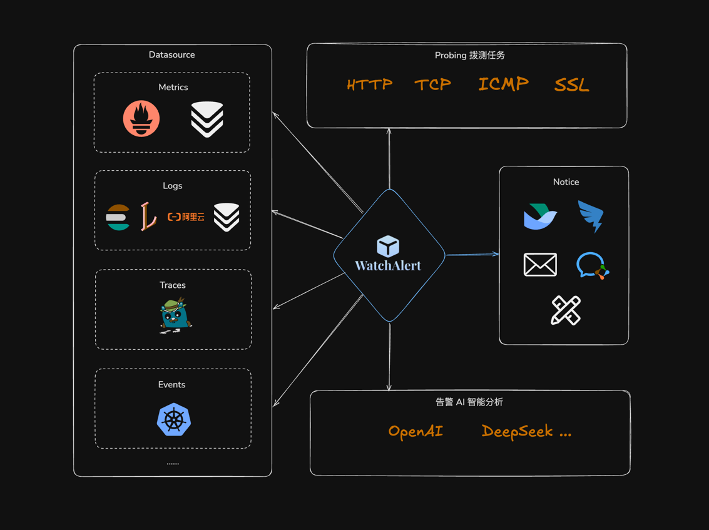

## 🔍 亮点

🌐 **统一可观测性**

- 统一接入 Metrics、Logs、Traces 和 Kubernetes Events，覆盖 Prometheus、Loki、Elasticsearch、VictoriaLogs、ClickHouse、阿里云 SLS、Jaeger、AWS CloudWatch 等数据源
- 在同一套告警规则与故障中心中关联多类观测数据，减少工具切换和信息割裂

🎯 **灵活的告警检测**

- 支持 PromQL、日志查询、Trace 状态、CloudWatch 指标和 Kubernetes 事件等多种检测方式
- 可配置评估周期、持续时间、告警等级、恢复条件和 Recording Rule，满足不同业务的监控需求

🧠 **AI 辅助分析**

- 结合告警规则、查询语句和事件内容生成分析结果，辅助判断异常原因
- 提供排查建议与修复思路，并支持深度分析，让告警信息更容易理解和处理

🚨 **完整的告警生命周期**

- 通过故障中心统一管理告警，支持分组聚合、去重、静默、认领、评论和历史追踪
- 支持多级告警升级、重复通知、超时处理和责任人转接，推动告警从发现到恢复闭环

🕰️ **值班与通知协同**

- 支持轮班排班、值班日历、节假日调整和交接，告警通知自动匹配当班责任人
- 支持飞书、钉钉、企业微信、邮件、Slack、Webhook、短信和电话等通知方式，并提供可自定义的通知模板

📡 **主动探测与故障发现**

- 支持 HTTP、TCP、ICMP 和 SSL 拨测，将可用性与延迟指标写入监控数据源
- 通过主动探测及时发现服务不可达、证书异常和网络连接问题

🔐 **多租户与权限管理**

- 支持多租户隔离、角色权限、API Key 和审计日志，适合团队协作与多环境管理
- 支持 LDAP 和 OIDC 等企业级身份接入，降低统一运维管理成本

## 📚 文档

- [功能介绍](https://cairry.github.io/docs/)
- [快速部署](https://cairry.github.io/docs/install/docker.html)

## 🎉 预览
| 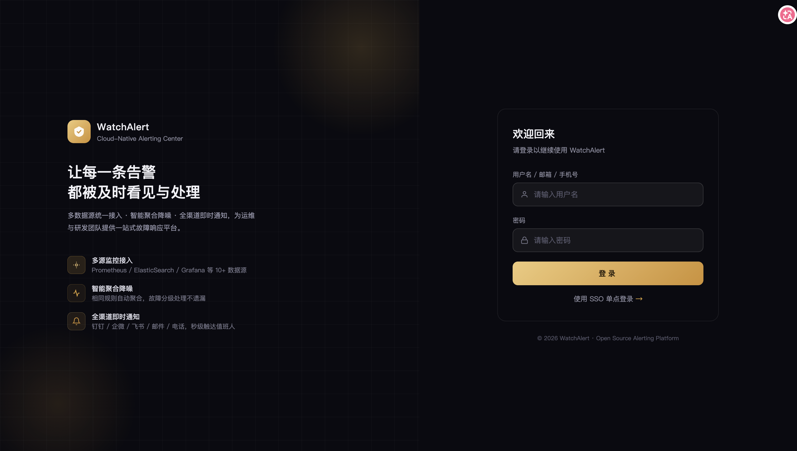 | 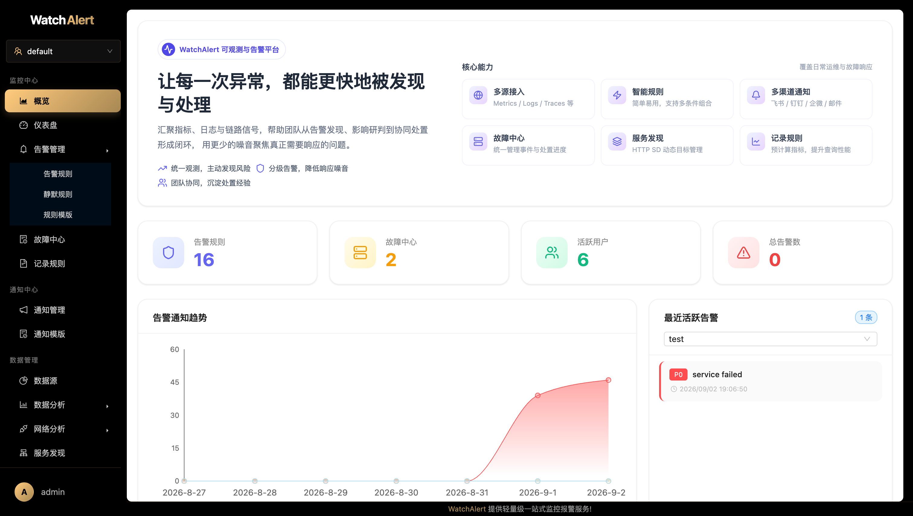            |
|:--------------------------:|------------------------------|
|    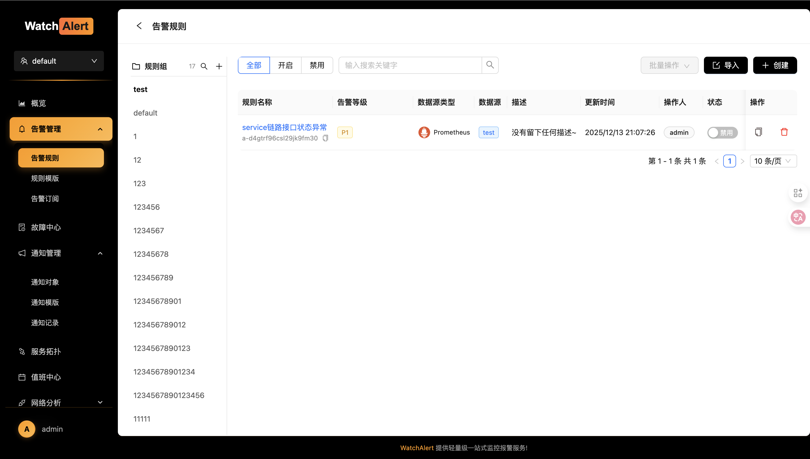     | 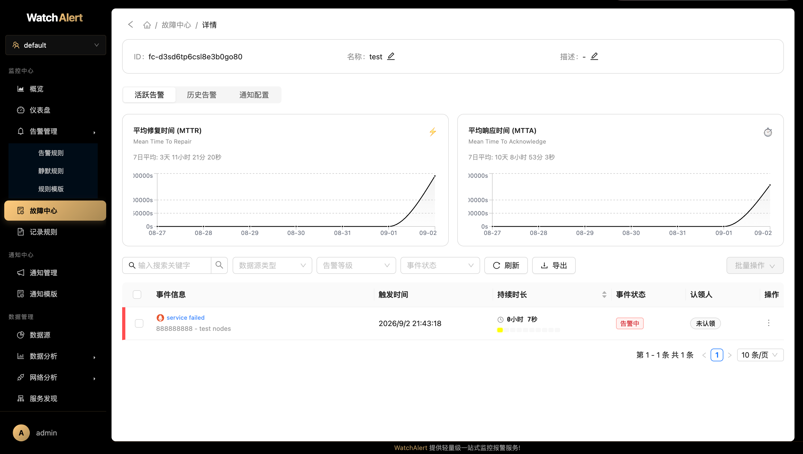  |
|   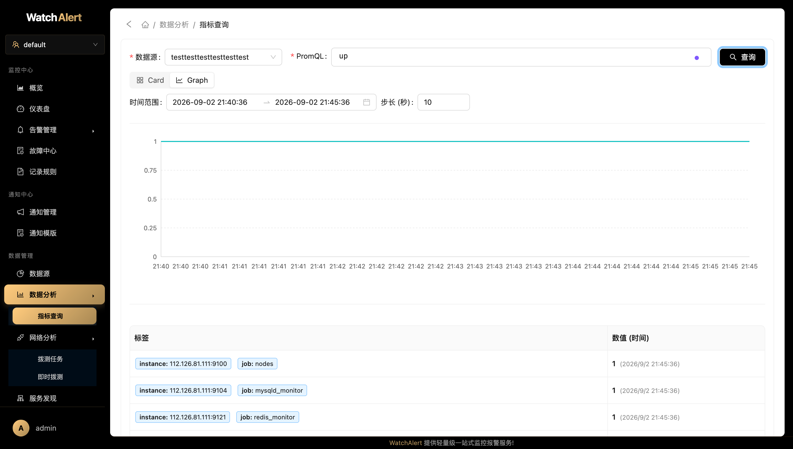    | 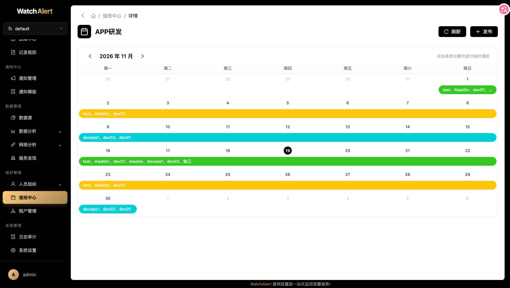           |
|  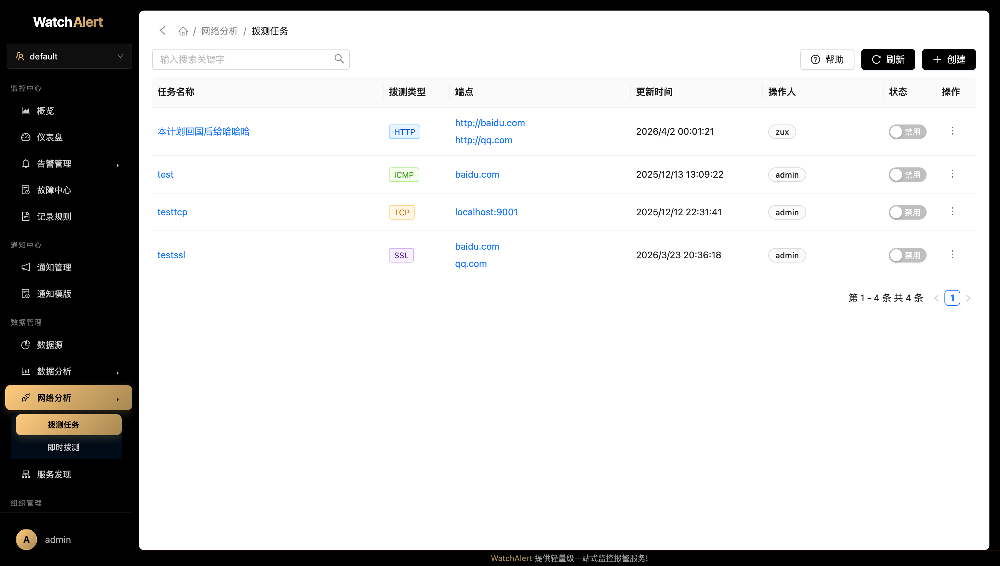   | 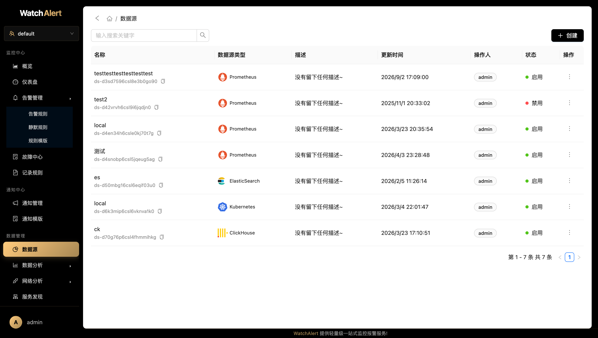|
|   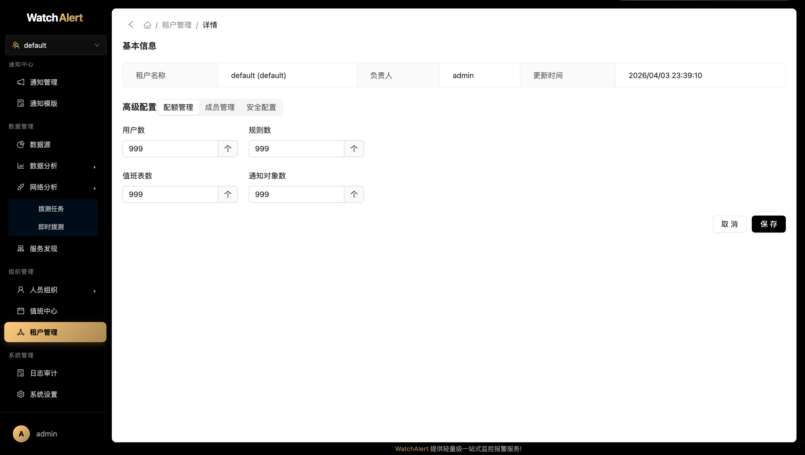      | 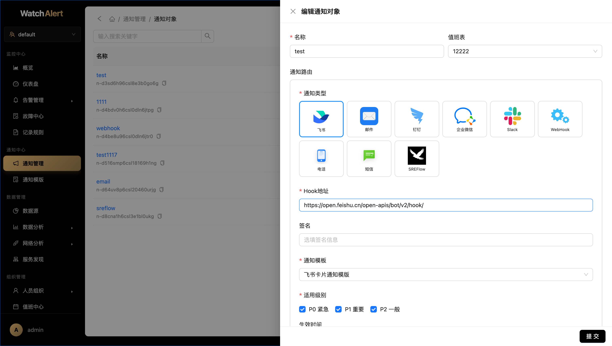             |

## 🧑‍💻 交流
- 搜索微信号 `Cairry8`，备注 `WatchAlert 入群`

## 🏆 赞助
- [前往查看](./sponsors-alternative.md)
- 欢迎通过项目顶部的 "**Sponsor**" 按钮支持我们！

## 🎸 支持
- 如果你觉得 WatchAlert 还不错，可以通过 Star 来表示你的喜欢
- 在公司或个人项目中使用 WatchAlert，并帮忙推广给伙伴使用
